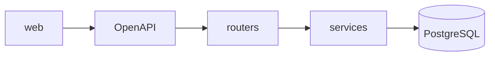
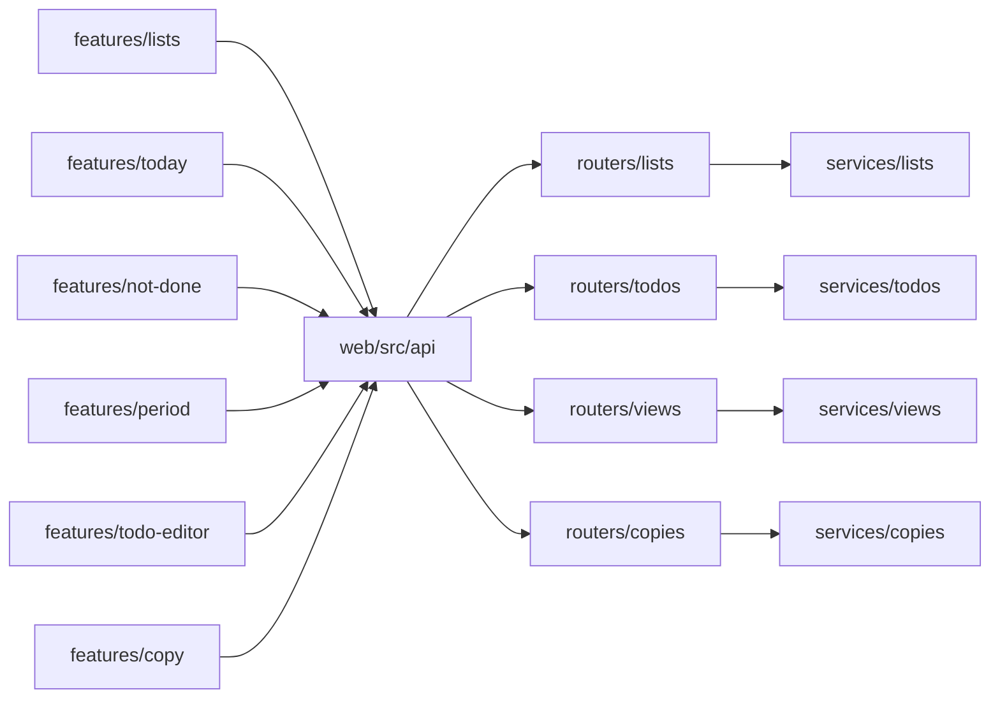
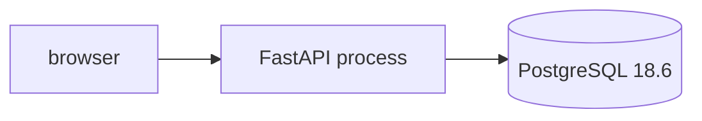
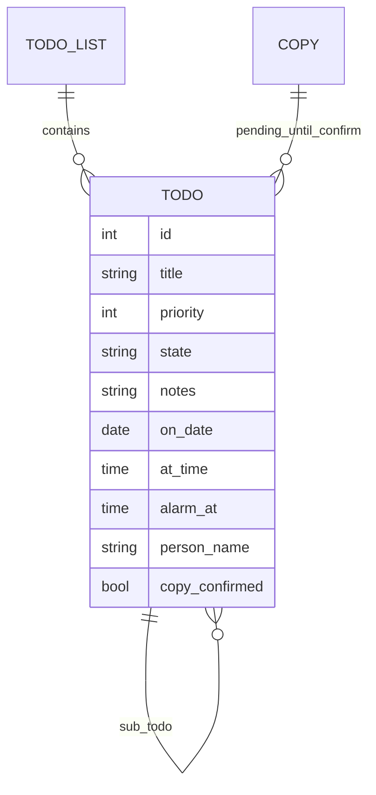

# Architecture Spine — Todo App

## Design Paradigm

Layered. The browser talks only to the HTTP contract. Routers call services. Services are the only code that writes PostgreSQL.



## Invariants & Rules

### AD-1 — One dataset, no login [ADOPTED]

- **Binds:** all
- **Prevents:** a phone-width browser and a desktop browser keeping different to-dos.
- **Rule:** One PostgreSQL database holds every to-do. There is no sign-in and no account table. Anyone who can open the site can read and write that database through the app.

### AD-2 — Dependencies point inward [ADOPTED]

- **Binds:** all
- **Prevents:** a router or a React component becoming a second writer of priority, partial, or copy-confirm.
- **Rule:** `web` depends on the OpenAPI contract only. Routers depend on services. Services are the only callers of SQLAlchemy. No edge points the other way.

### AD-3 — One origin, one contract [ADOPTED]

- **Binds:** all
- **Prevents:** a second host and a second to-do schema.
- **Rule:** FastAPI does not render the product HTML. In production FastAPI serves the built frontend from the same origin. OpenAPI generated by the server is the only shared contract. Interactive API docs are off in production. The API is not a public or third-party API.

### AD-4 — The server enforces the product rules [ADOPTED]

- **Binds:** FR-5, FR-6, FR-8, FR-9, FR-10, FR-11, FR-13, FR-15, FR-16, FR-17
- **Prevents:** the frontend accepting a state the server would later reject, or the reverse.
- **Rule:** A write that breaks these is rejected. Priority is an integer 1 through 5, and 5 is highest. State is `not_done`, `partial`, or `done`. Partial stores notes and does not store a progress number. The server never creates a to-do on its own. There is no authentication endpoint and no calendar endpoint. A person named on a to-do is text on that row, not a user.

### AD-5 — An unconfirmed copy is invisible [ADOPTED]

- **Binds:** FR-15
- **Prevents:** a pending copy that exists only in one browser, and a copy that shows up before confirm.
- **Rule:** The server stores the copy. No list and no view returns it until confirm. Confirm is a server transition. A later Saturday does not receive those to-dos unless the user copies and confirms again.

### AD-6 — The HTTP surface is this resource set [ADOPTED]

- **Binds:** FR-1 through FR-17, except withdrawn FR-14
- **Prevents:** the React app and the server inventing different paths or bodies.
- **Rule:** Product traffic uses only the routes and bodies in **API Contract**. A route for sign-in, calendar, alarm delivery, or a progress number does not exist. Collection responses are JSON arrays, or the object named for that view. Errors stay `{ "detail": string }`.

### AD-7 — Components match the route groups [ADOPTED]

- **Binds:** all
- **Prevents:** a second to-do type in the browser, and a router that implements a view the service does not own.
- **Rule:** The modules in **Components** are the ones that exist. `web` feature folders call the generated client and do not declare their own to-do type. Each server router calls only its matching service.

## API Contract

Prefix `/api`. A normal create sets `copy_confirmed` true. Reads that feed the UI return only rows with `copy_confirmed` true, except `GET /api/copies/{copy_id}`.

**To-do body.** `title` is the words Tom sees. `priority` is required on create. `state` defaults to `not_done`.

| Field | Type |
| --- | --- |
| id | int, server-assigned |
| list_id | int |
| parent_id | int or null |
| position | int |
| title | string |
| state | `not_done`, `partial`, or `done` |
| priority | int, 1 through 5 |
| notes | string |
| on_date | `YYYY-MM-DD` or null |
| at_time | `HH:MM:SS` or null |
| alarm_at | `HH:MM:SS` or null. Rejected when `at_time` is null. |
| person_name | string or null |
| copy_id | int or null |
| copy_confirmed | bool |

**Lists**

| Method and path | Body | Returns |
| --- | --- | --- |
| `GET /api/lists` | | array of `{ id, name, position }` |
| `POST /api/lists` | `{ name }` | the list |
| `PATCH /api/lists/{list_id}` | `{ name }` | the list |
| `DELETE /api/lists/{list_id}` | | empty. Deletes its to-dos. |

**To-dos**

| Method and path | Body | Returns |
| --- | --- | --- |
| `GET /api/lists/{list_id}/todos` | | confirmed to-dos on that list, `position` order |
| `POST /api/lists/{list_id}/todos` | to-do fields except ids and `copy_*` | the to-do. `parent_id` creates a sub-to-do. |
| `GET /api/todos/{todo_id}` | | the to-do, including an unconfirmed copy |
| `PATCH /api/todos/{todo_id}` | any to-do field except ids and `copy_*` | the to-do. This is how mark-done, mark-not-done, partial, notes, priority, time, alarm, and person name are written. |
| `DELETE /api/todos/{todo_id}` | | empty. Also deletes its sub-to-dos. |

**Views.** Every `todos` array here is confirmed only.

| Method and path | Body | Returns |
| --- | --- | --- |
| `GET /api/views/today?on_date=` | `on_date` required | `{ on_date, todos, next_todo_id }`. `todos` are confirmed rows with that `on_date`, `at_time` optional, `position` order. `next_todo_id` is the first of those whose `state` is not `done`, or null. |
| `GET /api/views/not-done` | | confirmed to-dos whose `state` is not `done`, including `partial` and rows with no `on_date` |
| `GET /api/views/period?grain=&anchor=` | `grain` is `day`, `week`, `month`, or `year`. `anchor` is a date. | `{ grain, anchor, todos, undated }`. `todos` have `on_date` inside the period that contains `anchor`. `undated` are confirmed to-dos with no `on_date`. The screen does not yet decide where `undated` is drawn. |

**Copy**

| Method and path | Body | Returns |
| --- | --- | --- |
| `POST /api/copies` | `{ source_list_id, destination_list_id, on_date }` | `{ id, todos }`. Copies every confirmed to-do on the source list, including sub-to-dos. New rows have `copy_confirmed` false and this `on_date`. They appear in no view. |
| `GET /api/copies/{copy_id}` | | `{ id, todos }` including unconfirmed rows |
| `POST /api/copies/{copy_id}/confirm` | | the same to-dos with `copy_confirmed` true |

## Components

```text
server/app/routers/lists.py
server/app/routers/todos.py
server/app/routers/views.py
server/app/routers/copies.py
server/app/services/lists.py
server/app/services/todos.py
server/app/services/views.py
server/app/services/copies.py
server/app/models.py
server/app/schemas.py
web/src/api/                 # generated from OpenAPI. The only to-do type.
web/src/features/lists/
web/src/features/today/
web/src/features/not-done/
web/src/features/period/
web/src/features/todo-editor/
web/src/features/copy/
```



## Consistency Conventions

| Concern | Convention |
| --- | --- |
| Naming | JSON properties are snake_case, matching the Pydantic models. The frontend does not hand-rename them. |
| Identifiers | Integer primary keys. Listing every to-do is already allowed, so opaque ids add nothing. |
| Time | A to-do time is a calendar date plus a time-of-day. No timezone is stored. |
| Errors | A failed write returns FastAPI's `detail` string. No second error envelope. |
| State | Product rules in AD-4 run in services. Routers do not open a SQLAlchemy session to apply a rule. |

## Stack

| Name | Version |
| --- | --- |
| Python | >=3.10 |
| FastAPI | 0.162.0 |
| PostgreSQL | 18.6 |
| SQLAlchemy | 2.1.8 |
| Alembic | 1.20.1 |
| Vite | 8.3.5 |
| React | 19.3.1 |
| @vitejs/plugin-react | 6.2.1 |
| TypeScript | as installed with the Vite React starter |

## Structural Seed

One process in production. It serves the API and the built frontend. PostgreSQL 18.6 runs beside it. The host and the provider are not chosen.



```text
server/app/routers/     # lists, todos, views, copies
server/app/services/    # the only writers
server/app/models.py
server/app/schemas.py
web/src/api/            # generated client
web/src/features/       # lists, today, not-done, period, todo-editor, copy
```



## Capability → Architecture Map

| Capability / Area | Lives in | Governed by |
| --- | --- | --- |
| FR-1 lists | `features/lists`, `services/lists` | AD-6, AD-7 |
| FR-2 Today, FR-7 what is next | `features/today`, `GET /api/views/today` | AD-5, AD-6 |
| FR-3 not-done view | `features/not-done`, `GET /api/views/not-done` | AD-6 |
| FR-4 period views | `features/period`, `GET /api/views/period` | AD-6 |
| FR-5–FR-13, FR-16, FR-17 to-do writes | `features/todo-editor`, `services/todos` | AD-4, AD-6 |
| FR-10 sub-to-dos | `parent_id` on create | AD-4 |
| FR-15 copy then confirm | `features/copy`, `services/copies` | AD-5, AD-6 |
| FR-14 calendar | no route | Deferred |

## Deferred

- Where `undated` is drawn on the week, month, and year screens. The payload returns those rows. Placement is still open.
- How early an alarm fires, and whether any scheduler exists. The row may store a time. Delivery is not designed.
- Which timezone "today" uses. Times are stored without a zone so a zone is not invented here.
- Working title.
- Ballet pickup at 2:30pm versus the lesson end. Product assumption, not a structural choice.
- Where the process and PostgreSQL are hosted. One process and one database are fixed. The provider is not.
- Authentication and calendar. Out of v1. Do not add them under another name.
