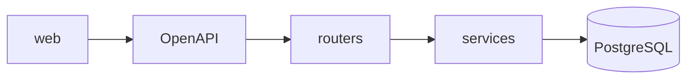
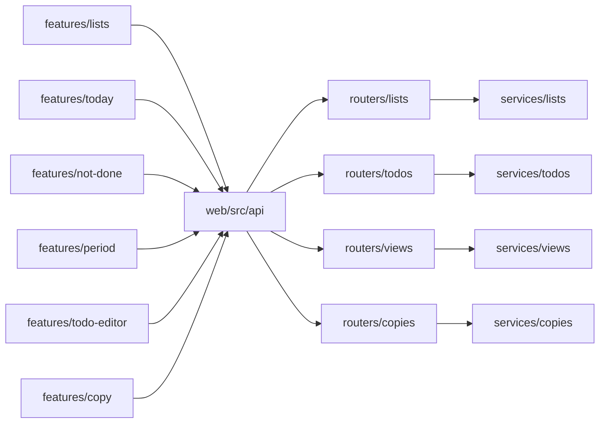
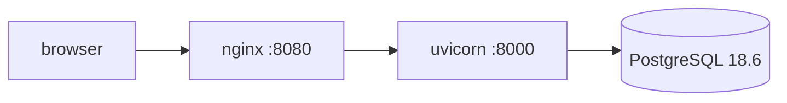
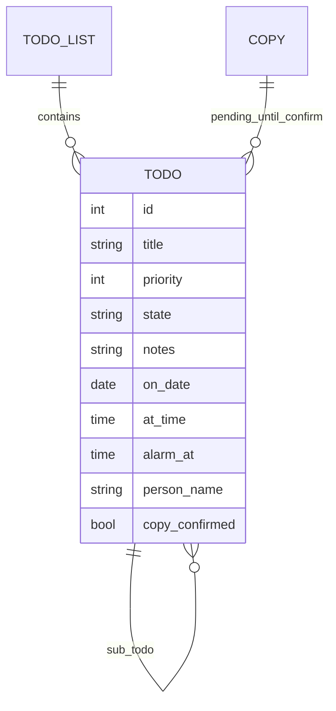

# Architecture Spine — Todo App

## Design Paradigm

Layered. The browser talks only to the HTTP contract. Product routers call services. Services are the only product code that writes PostgreSQL. The health route is the one exception, and it only runs `SELECT 1`.



`routers/health.py` may open the engine for `SELECT 1`. No other router does.

## Invariants & Rules

### AD-1 — One dataset, no login [ADOPTED]

- **Binds:** all
- **Prevents:** a phone-width browser and a desktop browser keeping different to-dos.
- **Rule:** One product database holds the to-dos the site shows. There is no sign-in and no account table. Anyone who can open the site can read and write that database through the app. The Compose test profile uses a separate database named `todo_test`. Tests truncate that database. They do not write the product database.

### AD-2 — Dependencies point inward [ADOPTED]

- **Binds:** all
- **Prevents:** a router or a React component becoming a second writer of priority, partial, or copy-confirm.
- **Rule:** `web` depends on the OpenAPI contract only. Product routers depend on services. Services are the only callers of SQLAlchemy for product data. `routers/health.py` may use the engine for `SELECT 1` and does not call a service. No other edge points the other way.

### AD-3 — One origin, one contract [ADOPTED]

- **Binds:** all
- **Prevents:** a second host and a second to-do schema.
- **Rule:** FastAPI does not render the product HTML. The browser has one origin. Compose publishes that origin on the web container: nginx serves the built frontend and proxies `/api` to the API container. When `web/dist` is present beside the server, FastAPI also serves those files. OpenAPI generated by the server is the only shared contract. Interactive API docs are off. The API is not a public or third-party API.

### AD-4 — The server enforces the product rules [ADOPTED]

- **Binds:** FR-5, FR-6, FR-8, FR-9, FR-10, FR-11, FR-13, FR-15, FR-16, FR-17
- **Prevents:** the frontend accepting a state the server would later reject, or the reverse.
- **Rule:** A write that breaks these is rejected. Priority is an integer 1 through 5, and 5 is highest. State is `not_done`, `partial`, or `done`. Partial stores notes and does not store a progress number. The server never creates a to-do on its own. There is no authentication endpoint and no calendar endpoint. A person named on a to-do is text on that row, not a user.

### AD-5 — An unconfirmed copy is invisible [ADOPTED]

- **Binds:** FR-15
- **Prevents:** a pending copy that exists only in one browser, and a copy that shows up before confirm.
- **Rule:** The server stores the copy. No list and no view returns it until confirm. `GET /api/todos/{todo_id}` and `GET /api/copies/{copy_id}` may return it so confirm can run. Confirm is a server transition. A later Saturday does not receive those to-dos unless the user copies and confirms again.

### AD-6 — The HTTP surface is this resource set [ADOPTED]

- **Binds:** FR-1 through FR-17, except withdrawn FR-14
- **Prevents:** the React app and the server inventing different paths or bodies.
- **Rule:** Product traffic uses only the routes and bodies in **API Contract**. A route for sign-in, calendar, alarm delivery, or a progress number does not exist. Collection responses are JSON arrays, or the object named for that view. Product-route errors stay `{ "detail": string }`. `GET /api/health` uses the status body in AD-10.

### AD-7 — Components match the route groups [ADOPTED]

- **Binds:** all
- **Prevents:** a second to-do type in the browser, and a router that implements a view the service does not own.
- **Rule:** The modules in **Components** are the ones that exist. `web` feature folders call the generated client and do not declare their own to-do type. Each product router calls only its matching service. The health router has no service.

### AD-8 — Undated rows sit under a No date heading [ADOPTED]

- **Binds:** FR-4
- **Prevents:** one period screen hiding undated rows and another placing them on a day inside the period.
- **Rule:** On day, week, month, and year, dated rows render first. Confirmed to-dos with no `on_date` render under them in a section headed "No date". They are not placed on a day inside the period. Changing the period does not remove them from that section.

### AD-9 — An alarm is shown and never fired [ADOPTED]

- **Binds:** FR-13
- **Prevents:** one unit adding a scheduler, a push, or a sound while another only stores the time.
- **Rule:** `alarm_at` is stored and shown on the to-do. No job, route, or client timer fires it. There is no lead time and no delivery. On create and after a patch is applied, `alarm_at` is rejected when the stored `at_time` is null.

### AD-10 — Health is one probe [ADOPTED]

- **Binds:** all
- **Prevents:** a second liveness path or a body the Compose healthcheck cannot read.
- **Rule:** `GET /api/health` is the only health route. It returns `{ "status": "ok" }` with 200 when PostgreSQL accepts `SELECT 1`, and `{ "status": "unavailable" }` with 503 otherwise. The API container and `server/Dockerfile` runtime healthcheck call that URL.

### AD-11 — One ship path and one test path [ADOPTED]

- **Binds:** all
- **Prevents:** a second test runner, a third image, or a Compose service outside `compose.yaml`.
- **Rule:** Web unit tests run on Vitest. Browser tests run on Playwright against the Compose web origin. API tests run on pytest. Images are `server/Dockerfile` (targets `build`, `test`, `runtime`) and `web/Dockerfile`. Compose services are `postgres`, `api`, `web`, and `tests`. The only profile is `test`, and only `tests` uses it. The default stack is `postgres`, `api`, and `web`. Published host ports bind to `127.0.0.1`. Compose does not publish the API container port. A process started outside Compose may listen on `127.0.0.1:8000` so the Vite dev server can proxy `/api`. That listener is not a second product origin. Profile `test` uses database `todo_test` and does not touch the product database. There is no cloud provider.

### AD-12 — The browser supplies the calendar date [ADOPTED]

- **Binds:** FR-2, FR-4
- **Prevents:** Today and the period screen choosing two different calendar days, and the server inventing a zone.
- **Rule:** When the page has no date in the query, it sends the browser's local calendar date. The server stores and compares that date. It does not convert zones.

## API Contract

Prefix `/api`. A normal create sets `copy_confirmed` true. Reads that feed the UI return only rows with `copy_confirmed` true, except `GET /api/todos/{todo_id}` and `GET /api/copies/{copy_id}`.

**To-do body.** `title` is the words Tom sees. `priority` is required on create. `state` defaults to `not_done`.

| Field | Type |
| --- | --- |
| id | int, server-assigned |
| list_id | int |
| parent_id | int or null |
| position | int |
| title | string |
| state | `not_done`, `partial`, or `done` |
| priority | int, 1 through 5 |
| notes | string |
| on_date | `YYYY-MM-DD` or null |
| at_time | `HH:MM:SS` or null |
| alarm_at | `HH:MM:SS` or null. Rejected when `at_time` is null. Shown. Never fired. |
| person_name | string or null |
| copy_id | int or null |
| copy_confirmed | bool |

**Health**

| Method and path | Body | Returns |
| --- | --- | --- |
| `GET /api/health` | | `{ "status": "ok" }` with 200, or `{ "status": "unavailable" }` with 503 |

**Lists**

| Method and path | Body | Returns |
| --- | --- | --- |
| `GET /api/lists` | | array of `{ id, name, position }`, ordered by `position`, then `id` |
| `POST /api/lists` | `{ name }` | the list |
| `PATCH /api/lists/{list_id}` | `{ name }` | the list |
| `DELETE /api/lists/{list_id}` | | empty. One delete of that row. The list foreign key cascades to its to-dos. |

**To-dos**

| Method and path | Body | Returns |
| --- | --- | --- |
| `GET /api/lists/{list_id}/todos` | | confirmed to-dos on that list, including sub-to-dos, ordered by `position`, then `id` |
| `POST /api/lists/{list_id}/todos` | to-do fields except ids and `copy_*` | the to-do. `parent_id` is create-only. It must already exist on this list. A sub-to-do may have its own sub-to-dos. There is no depth cap. |
| `GET /api/todos/{todo_id}` | | the to-do, including an unconfirmed copy |
| `PATCH /api/todos/{todo_id}` | only the sent fields among title, state, priority, notes, position, `on_date`, `at_time`, `alarm_at`, `person_name` | the to-do. Omitted fields stay. `parent_id` and `list_id` are not patchable. |
| `DELETE /api/todos/{todo_id}` | | empty. One delete of that row. The parent foreign key cascades to its sub-to-dos. |

**Views.** Every `todos` array here is confirmed only.

| Method and path | Body | Returns |
| --- | --- | --- |
| `GET /api/views/today?on_date=` | `on_date` required. When the page has no date in the query, the browser sends its local calendar date. | `{ on_date, todos, next_todo_id }`. `todos` are confirmed rows with that `on_date`, including sub-to-dos, ordered by `position`, then `id`. `next_todo_id` is the single first of those whose `state` is not `done`, or null. |
| `GET /api/views/not-done` | | confirmed to-dos whose `state` is not `done`, including `partial`, sub-to-dos, and rows with no `on_date`, ordered by `list_id`, then `position`, then `id` |
| `GET /api/views/period?grain=&anchor=` | `grain` is `day`, `week`, `month`, or `year`. `anchor` is a date. A week is Monday through Sunday containing `anchor`. A month is that calendar month. A year is that calendar year. When the page has no date in the query, the browser sends its local calendar date. | `{ grain, anchor, todos, undated }`. `todos` have `on_date` inside that period, ordered by `on_date`, then `position`, then `id`. `undated` are confirmed to-dos with no `on_date`, ordered by `position`, then `id`. Both include sub-to-dos that match. The screen shows `todos` first, then a section headed "No date". |

**Copy**

| Method and path | Body | Returns |
| --- | --- | --- |
| `POST /api/copies` | `{ source_list_id, destination_list_id, on_date }` | `{ id, todos }`. Copies every confirmed to-do on the source list onto the destination list. Each new row keeps title, state, priority, notes, `at_time`, `alarm_at`, `person_name`, and `position`. Parent links are remapped to the new rows. `on_date` is the copy date. `copy_confirmed` is false. They appear in no view. |
| `GET /api/copies/{copy_id}` | | `{ id, todos }` including unconfirmed rows |
| `POST /api/copies/{copy_id}/confirm` | | the same to-dos with `copy_confirmed` true |

## Components

```text
server/app/routers/health.py
server/app/routers/lists.py
server/app/routers/todos.py
server/app/routers/views.py
server/app/routers/copies.py
server/app/services/lists.py
server/app/services/todos.py
server/app/services/views.py
server/app/services/copies.py
server/app/models.py
server/app/schemas.py
web/src/api/                 # generated from OpenAPI. The only to-do type.
web/src/features/lists/
web/src/features/today/
web/src/features/not-done/
web/src/features/period/
web/src/features/todo-editor/
web/src/features/copy/
```



## Consistency Conventions

| Concern | Convention |
| --- | --- |
| Naming | JSON properties are snake_case, matching the Pydantic models. The frontend does not hand-rename them. |
| Identifiers | Integer primary keys. Listing every to-do is already allowed, so opaque ids add nothing. |
| Time | A to-do time is a calendar date plus a time-of-day. No timezone is stored. The client date rule is AD-12. |
| Errors | A failed product write returns FastAPI's `detail` string. No second error envelope. Health uses AD-10. |
| State | Product rules in AD-4 run in services. Product routers do not open a SQLAlchemy session to apply a rule. |
| Client calls | The generated client calls relative `/api` paths. It does not embed a second host. |
| Routing | `react-router-dom` is the only page router. Feature folders do not add another. |
| Landing | `/` is Today. The other pages are `/not-done`, `/lists`, `/lists/:listId`, `/period`, and `/copies/:copyId`. |
| Driver | psycopg is the PostgreSQL driver, and only through SQLAlchemy. |

## Stack

| Name | Version |
| --- | --- |
| Python | 3.12 |
| FastAPI | 0.162.0 |
| uvicorn | 0.54.0 |
| PostgreSQL | 18.6 |
| SQLAlchemy | 2.1.8 |
| psycopg | 3.3.8 |
| Alembic | 1.20.1 |
| Node | 22 |
| nginx | 1.27 |
| Vite | 8.3.5 |
| React | 19.3.1 |
| react-router-dom | 7.18.5 |
| @vitejs/plugin-react | 6.2.1 |
| TypeScript | 6.0.3 |
| Vitest | 5.1.0 |
| @playwright/test | 1.64.1 |
| pytest | 9.2.0 |

## Structural Seed

Compose is the ship path. The browser origin is the web container. nginx serves the built frontend and proxies `/api` to the API. The API process runs uvicorn on port 8000 after `alembic upgrade head`. It also serves `web/dist` when that directory is present. The project requires Python >=3.11. The images run Python 3.12. A local Vite server proxies `/api` to `127.0.0.1:8000` and does not publish a second product host.



```text
compose.yaml                 # postgres, api, web; profile test runs tests
server/Dockerfile            # targets build, test, runtime
web/Dockerfile               # Node 22 build, nginx 1.27 runtime
server/app/routers/          # health, lists, todos, views, copies
server/app/services/         # the only product writers
server/app/models.py
server/app/schemas.py
web/src/api/                 # generated client
web/src/features/            # lists, today, not-done, period, todo-editor, copy
```



## Capability → Architecture Map

| Capability / Area | Lives in | Governed by |
| --- | --- | --- |
| FR-1 lists | `features/lists`, `services/lists` | AD-6, AD-7 |
| FR-2 Today, FR-7 what is next | `features/today`, `GET /api/views/today` | AD-5, AD-6, AD-12 |
| FR-3 not-done view | `features/not-done`, `GET /api/views/not-done` | AD-6 |
| FR-4 period views | `features/period`, `GET /api/views/period` | AD-6, AD-8, AD-12 |
| FR-5–FR-13, FR-16, FR-17 to-do writes | `features/todo-editor`, `services/todos` | AD-4, AD-6 |
| FR-10 sub-to-dos | `parent_id` on create, cascade on delete | AD-4, AD-6 |
| FR-13 alarm | `alarm_at` on the to-do row | AD-4, AD-9 |
| FR-15 copy then confirm | `features/copy`, `services/copies` | AD-5, AD-6 |
| FR-14 calendar | no route | Deferred |
| Health | `GET /api/health`, `routers/health.py` | AD-10 |
| Ship and test | `compose.yaml`, `server/Dockerfile`, `web/Dockerfile` | AD-11 |

## Deferred

- Working title.
- Ballet pickup at 2:30pm versus the lesson end. Product assumption, not a structural choice.
- A provider other than the machine that runs Compose. The ship path is the Compose file. No cloud provider is in the repo.
- Authentication and calendar. Out of v1. Do not add them under another name.
